# 运行记录 2026-11-11 · dba68d08

本文件只记录这一次人工浏览器验收。以后的提交即使进入 `main`，也不改写这里的 SHA 和结论。笔误在文末追加「更正」，不覆盖原段落。

## 运行字段

| 字段 | 值 |
| --- | --- |
| 测试 SHA | [`dba68d08f7b48178a7ae208f18ff5dba84317df4`](https://github.com/weiguangchao/openai-translate-chrome-extension/commit/dba68d08f7b48178a7ae208f18ff5dba84317df4) |
| 分支起点 | 当时的 `main`。该提交标题为 Merge pull request #157 from weiguangchao/t3/review-product-feedback |
| 版本 | manifest `0.1.2`；产品名 Subline ·20261111 |
| 日期 | 2026-11-11 |
| 时段 | 19:12–19:27 |
| 时区 | Asia/Taipei |
| 扩展 ID | `lanjbmaenpfbpdjjmjdedococodoiboe`（原位 Reload 后由扩展卡片确认） |
| 环境 | 本机已配置 Subline 的 Chrome。对该扩展点击 Reload，不更换已解压路径。扩展卡片显示 Subline ·20261111、0.1.2，且为开启。同页 Sand Accept-Language 为关闭。同页另有已关闭的扩展，未参与功能验证。记录写明未改浏览器 profile，也未改扩展存储。 |
| 测试页 | <https://www.youtube.com/watch?v=qp0HIF3SfI4> ；<https://x.com/theo/status/2107935187825008691> |
| 网络 | 未确认 |
| 性能 | 未测。不引用其他轮次的性能数字 |
| 用例 | 12 |
| 确认缺陷 | 1（BUG-01，[#161](https://github.com/weiguangchao/openai-translate-chrome-extension/issues/161)） |

截图目录：[../assets/2026-11-11-dba68d08/](../assets/2026-11-11-dba68d08/)。17 张均来自这次运行的证据包，字节与证据包一致。扩展管理页截图含扩展 ID 和已关闭的其他扩展卡片；这些不作为密钥。各图未见 API key、token 或私钥。

## 状态一览

| 用例 | 状态 | 关联 | 证据 |
| --- | --- | --- | --- |
| TC-ENV-reload | pass | 无 | 有截图 |
| TC-158-X-small | partial | [#158](https://github.com/weiguangchao/openai-translate-chrome-extension/issues/158) | 有截图 |
| TC-X-fullscreen | blocked | [#158](https://github.com/weiguangchao/openai-translate-chrome-extension/issues/158) | 登录提示出现在已有 X 截图中；无单独全屏图 |
| TC-159-connection | pass | [#159](https://github.com/weiguangchao/openai-translate-chrome-extension/issues/159) | 未留截图 |
| TC-159-state-yt-off | fail | [#161](https://github.com/weiguangchao/openai-translate-chrome-extension/issues/161) | 有截图 |
| TC-159-state-yt-on | fail | [#161](https://github.com/weiguangchao/openai-translate-chrome-extension/issues/161) | 有截图 |
| TC-159-state-x-on | fail | [#161](https://github.com/weiguangchao/openai-translate-chrome-extension/issues/161) | 有截图 |
| TC-159-state-reopen | pass | [#161](https://github.com/weiguangchao/openai-translate-chrome-extension/issues/161) | 有截图 |
| TC-160-popup | pass | [#160](https://github.com/weiguangchao/openai-translate-chrome-extension/issues/160) | 有截图 |
| TC-160-style | pass | [#160](https://github.com/weiguangchao/openai-translate-chrome-extension/issues/160) | 有截图；恢复值不是原始快照 |
| TC-YT-playback | pass | 无 | 有截图 |
| TC-A11Y-smoke | pass | [#160](https://github.com/weiguangchao/openai-translate-chrome-extension/issues/160) | 未留截图 |

计数：`pass` 7，`fail` 3，`partial` 1，`blocked` 1。合计 12。这次没有单独标成 `not-tested` 的用例。BUG-01 验收清单里的仅译文模式和切换标签页没有执行，写在该缺陷的缺口里。

[#158](https://github.com/weiguangchao/openai-translate-chrome-extension/issues/158)、[#159](https://github.com/weiguangchao/openai-translate-chrome-extension/issues/159)、[#160](https://github.com/weiguangchao/openai-translate-chrome-extension/issues/160) 保持打开。本记录不关闭它们。

## BUG-01 同一 popup 展开期间，状态提示与开关和画面不一致

优先级：低 / P3。Issue：[#161](https://github.com/weiguangchao/openai-translate-chrome-extension/issues/161)。

失败用例：TC-159-state-yt-off、TC-159-state-yt-on、TC-159-state-x-on。重开后的阅读见 TC-159-state-reopen，该条为 pass。

画面上的字幕仍随开关变化：关闭后译文消失、原生英文仍在，再开启后双语可以恢复。本缺陷记录的是状态提示。即时检查跨 YouTube 与 X 共 3/3 复现。关闭并重新打开 popup 后 3/3 次提示正确。过期提示在不再操作时会保持多久，这次没有测量，这里不写时长。重开后的 3 次只说明那 3 次重开时提示是对的。

### 问题

已经打开的同一个 popup 里切换 **Bilingual subtitles** 之后，立刻查看时，状态提示与开关、以及当前标签页视频上的字幕不一致。

| 步骤 | 实际（即时检查） | 预期 |
| --- | --- | --- |
| YouTube：同一 popup 内关闭双语 | 译文消失，原生英文 CC 仍在，开关为关，提示仍为 Showing bilingual subtitles | 提示应为字幕已关闭，并与开关和画面一致 |
| YouTube：重开 popup | 提示为 Subtitles are off，与画面一致 | 一致 |
| YouTube：再次开启，画面已有双语，同一 popup 未关 | 提示为 Waiting for captions | 字幕已经显示时，提示应为正在显示双语。加载过程可以出现 Loading / Waiting |
| YouTube：再重开 popup | 提示为 Showing bilingual subtitles，与画面一致 | 一致 |
| X：开启后画面已有双语 | 提示为 Waiting for captions | 与 YouTube 开启后的预期相同 |

这次看到的原文字幕包括 YouTube 的 “I call it the golden circle.”，以及开启后的译文「我称之为“黄金圈”。」。X 上开启后的例子包括 “usually just touching a few files here and there.” / 「通常只是偶尔碰几个文件。」。

### 复现

1. 加载并原位 Reload 本记录的构建（Subline ·20261111 / 0.1.2 / `dba68d08`）。这次界面上的译文语言是简体中文。
2. 打开 <https://www.youtube.com/watch?v=qp0HIF3SfI4>，打开 Subline popup，保持不关闭。
3. 把 Bilingual subtitles 切到关。立刻对照开关、提示和画面。
4. 关闭 popup 再打开，再对照一次。
5. 在新打开的 popup 里再次打开双语。画面已经出现中英双语后，仍不关闭 popup，再看提示。
6. 再重开 popup 对照。
7. 在 <https://x.com/theo/status/2107935187825008691> 用同样方式做开启后的即时检查。

### 修改建议

下列三项是改法建议，这次没有证实它们就是根因：

- 订阅真实的本页字幕状态事件。
- 开关变化后立即更新提示。
- 切换标签页时重新获取当前页状态。

[#159](https://github.com/weiguangchao/openai-translate-chrome-extension/issues/159) 讨论的是设置页 Saved 与 Provider Not tested 的语义。[#160](https://github.com/weiguangchao/openai-translate-chrome-extension/issues/160) 讨论的是弹窗信息架构。两处都涉及「本页状态如何表达」，因此互相引用。它们不替代 BUG-01。

### 验收

修复后在 YouTube 和 X 上分别看。加载过程允许 Loading / Waiting；字幕已经显示后提示要更新。

- [ ] 关闭双语后，不必重开 popup，提示与开关、画面一致
- [ ] 开启双语且字幕已显示后，不必重开 popup，提示与画面一致
- [ ] 仅译文模式下，提示与画面一致，不必重开 popup
- [ ] 切换标签页后，提示与当前标签页实际状态一致

这次测了 YouTube 关闭、YouTube 开启、X 开启的即时检查，以及重开 popup。仅译文模式的即时提示、切换标签页后的即时提示，这次没有执行：不记失败，也不记通过。

### 截图

先看这次缺陷的五张图。E1–E4 是浏览器直接截下的真实画面。E5 是 E1 同一帧的裁切加红框，画面内容未改。

#### E1 真实截图 · TC-159-state-yt-off

YouTube 上关闭双语后的即时画面。译文已消失，原生英文 CC 为 “I call it the golden circle.”，Bilingual subtitles 开关为关，提示仍为 Showing bilingual subtitles。

#### E2 真实截图 · TC-159-state-yt-on

再次开启后，画面已有 “I call it the golden circle.” 和「我称之为“黄金圈”。」，开关为开，提示仍为 Waiting for captions。

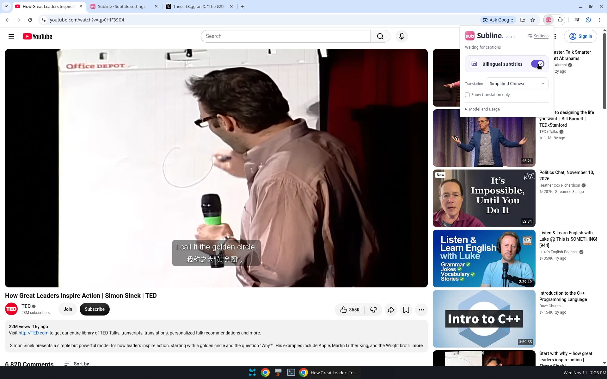

#### E3 真实截图 · TC-159-state-x-on

X 上开启后，画面已有双语（可见 “usually just touching a few files here and there.” 与中文译文），开关为开，提示仍为 Waiting for captions。同帧可见 X 的登录提示，那是 TC-X-fullscreen 受阻的页面条件。

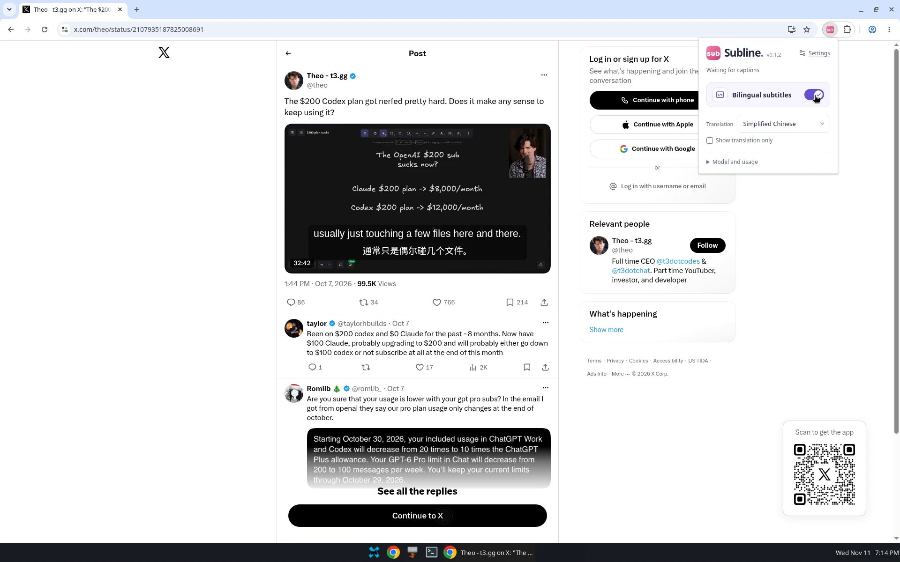

#### E4 真实截图 · TC-159-state-reopen

重开 popup 后，YouTube 画面仍是双语，开关为开，提示为 Showing bilingual subtitles。

#### E5 裁切标注 · 来自 E1 同一帧

由 `bug-01-youtube-off-stale-status.webp` 同一帧裁出，加了红框和编号。画面内容未改。图内说明写的是 Subline · 20261111、v0.1.2、main dba68d08、2026-11-11 19:26 Asia/Taipei。这是标注，不是修复建议稿。

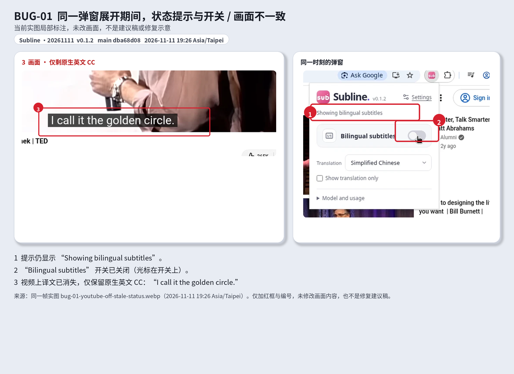

引用到 issue 时使用引入本目录的提交 SHA，不要用 `file://`：

`https://raw.githubusercontent.com/weiguangchao/openai-translate-chrome-extension/<提交 SHA>/docs/qa/assets/2026-11-11-dba68d08/<文件名>`

`https://github.com/weiguangchao/openai-translate-chrome-extension/blob/<提交 SHA>/docs/qa/assets/2026-11-11-dba68d08/<文件名>?raw=1`

| 标记 | 文件 | 种类 |
| --- | --- | --- |
| E1 | `bug-01-youtube-off-stale-status.webp` | 真实截图 |
| E2 | `bug-01-youtube-on-waiting-status.webp` | 真实截图 |
| E3 | `bug-01-x-after-enable-waiting-status.webp` | 真实截图 |
| E4 | `bug-01-youtube-status-recovered-after-reopen.webp` | 真实截图 |
| E5 | `bug-01-youtube-off-stale-status-annotated.png` | 同一帧裁切 + 红框，画面未改 |

## 分条结果

用例定义见 [../cases.md](../cases.md)。下面是这一次的实际结果。

### TC-ENV-reload · pass

- 实际：Reload 后出现 Reloaded 提示。卡片为 Subline ·20261111，版本 0.1.2，ID `lanjbmaenpfbpdjjmjdedococodoiboe`，开关为开。Sand Accept-Language 为关。
- 缺口：同页还有已关闭的其他扩展，未做功能验证。
- 证据：

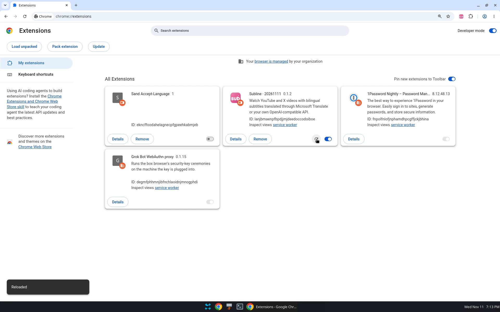

### TC-158-X-small · partial

- 实际：当时可见的小窗尺寸下，长句英文出现折行，译文未遮住原生控制条。没有再缩小播放器，也没有逐项核对画面上全部重要图文。该次打开 popup 时提示为 Showing bilingual subtitles，与当时画面一致。这一帧不是 BUG-01 的过期提示。
- 缺口：未覆盖更窄尺寸，未核对全部重要图文。不能把 [#158](https://github.com/weiguangchao/openai-translate-chrome-extension/issues/158) 视为已经修好。
- 证据：

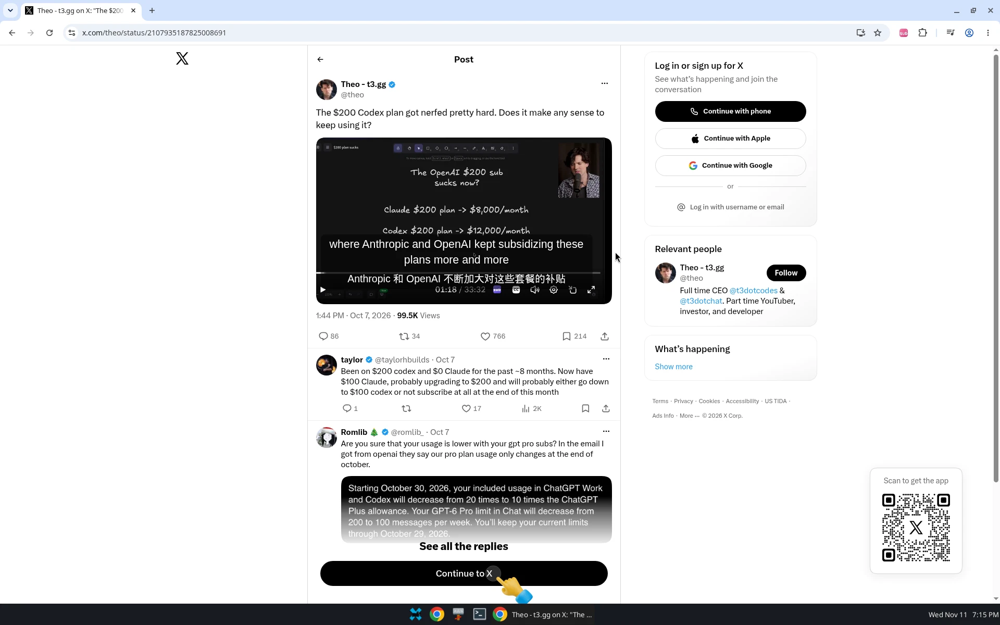

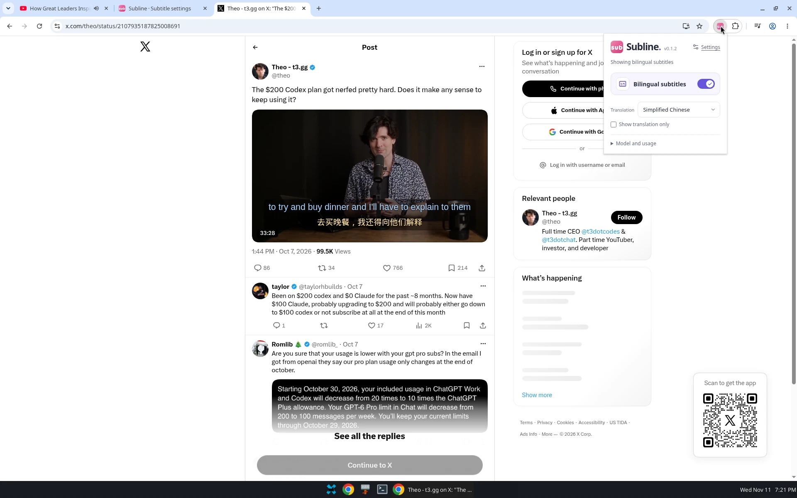

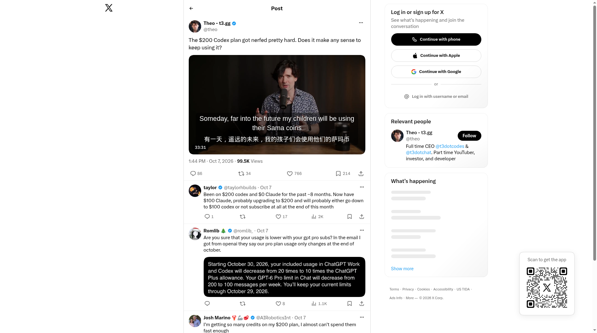

### TC-X-fullscreen · blocked

- 实际：页面出现 X 登录 / Continue to X 提示，全屏没有完成。这次没有登录，因此没有全屏结果。
- 缺口：没有单独的全屏失败截图。登录栏出现在上面的 X 截图里，包括 `x-small-window-controls-original.webp`。
- 说明：受阻原因是站点登录提示。这不是产品缺陷。

### TC-159-connection · pass

- 实际：Test connection 的结果文案为 Connection test passed。provider、base、model、key 在该操作中未改。重开 popup 后能看到与这次测试对应的状态。
- 缺口：未留截图。同一 popup 内切换开关后的提示不并入本条。
- 说明：本条通过不关闭 [#159](https://github.com/weiguangchao/openai-translate-chrome-extension/issues/159)。

### TC-159-state-yt-off · fail

- 实际：译文已消失，原生英文 CC 保留（I call it the golden circle.），开关为关，提示仍为 Showing bilingual subtitles。
- 缺口：未测量这段提示在无后续操作时持续多久。字幕渲染仍随开关变化，见 TC-YT-playback。
- 证据：E1、E5。

### TC-159-state-yt-on · fail

- 实际：先重开 popup 时提示为 Subtitles are off，与关闭后的画面一致。在随后这个 popup 里再次开启后，画面已有双语（I call it the golden circle. / 我称之为“黄金圈”。），开关为开，提示仍为 Waiting for captions。
- 缺口：未记录从开启到截图的毫秒数。未测仅译文模式。
- 证据：E2。

### TC-159-state-x-on · fail

- 实际：画面已有双语（usually just touching a few files here and there. / 通常只是偶尔碰几个文件。），开关为开，提示仍为 Waiting for captions。
- 缺口：这是跨 YouTube / X 的 3 次即时检查之一。X 上关闭开关后的即时提示，这次没有单独一条用例。
- 证据：E3。

### TC-159-state-reopen · pass

- 实际：重开后 3/3 次提示正确。YouTube 在双语已经显示时重开，提示为 Showing bilingual subtitles，与开关和画面一致。
- 缺口：只覆盖这 3 次重开。未测静置多久会自行更新。
- 证据：E4。

### TC-160-popup · pass

- 实际：Settings 带文字标签。Model and usage 可以展开，该帧可见模型 `mimo-v2.6-flash` 与 Token usage（约 343.5K；Input 289.7K / Output 53.9K / Cache 40.7K），也可以收起。Subtitle style 可以进入。
- 缺口：只覆盖入口和折叠。用量是该帧读数，不是性能指标。[#160](https://github.com/weiguangchao/openai-translate-chrome-extension/issues/160) 的信息架构建议仍是建议，不是本轮新开的缺陷，也不因本条而关闭。
- 证据：

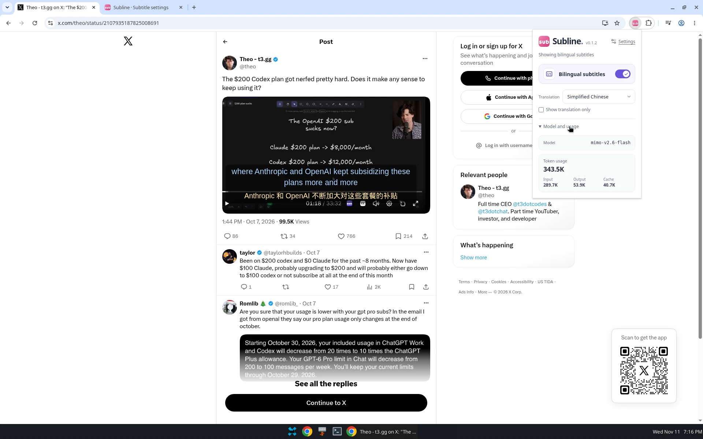

### TC-160-style · pass

- 实际：临时颜色为 Source `#A0D5FF`、Translation `#FFE3A3`，字号 24px / 22px，间距 6px，背景 45%。预览与 X、YouTube 画面一致。随后恢复为两侧 `#FFFFFF`、24px / 22px、间距 6px、背景 45%。仅译文为未勾选，双语为开。
- 缺口：上述白色和尺寸是恢复之后当时看到的值。这次没有改色前的完整对照，不能把它们当作原始状态快照，也不表示每一个细节都与改色之前相同。
- 证据：

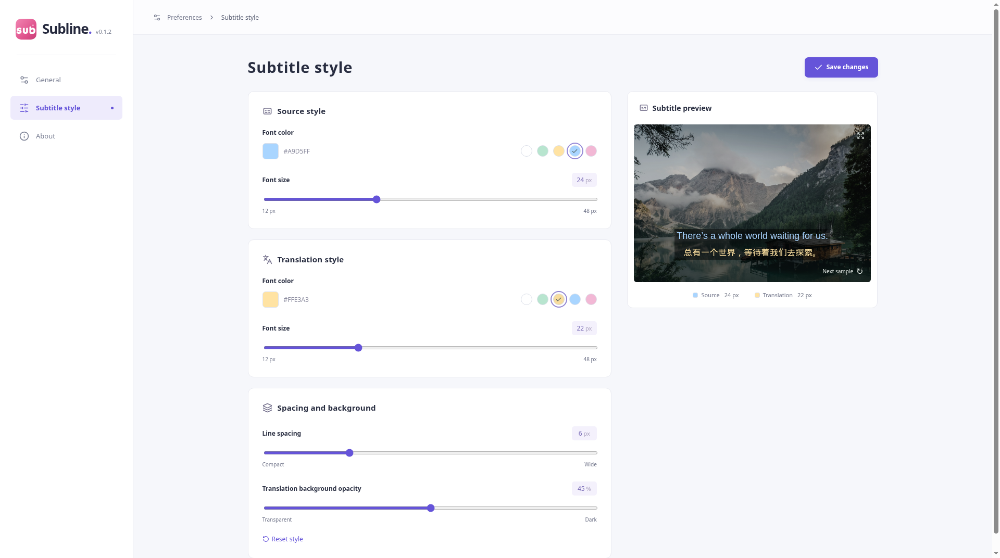

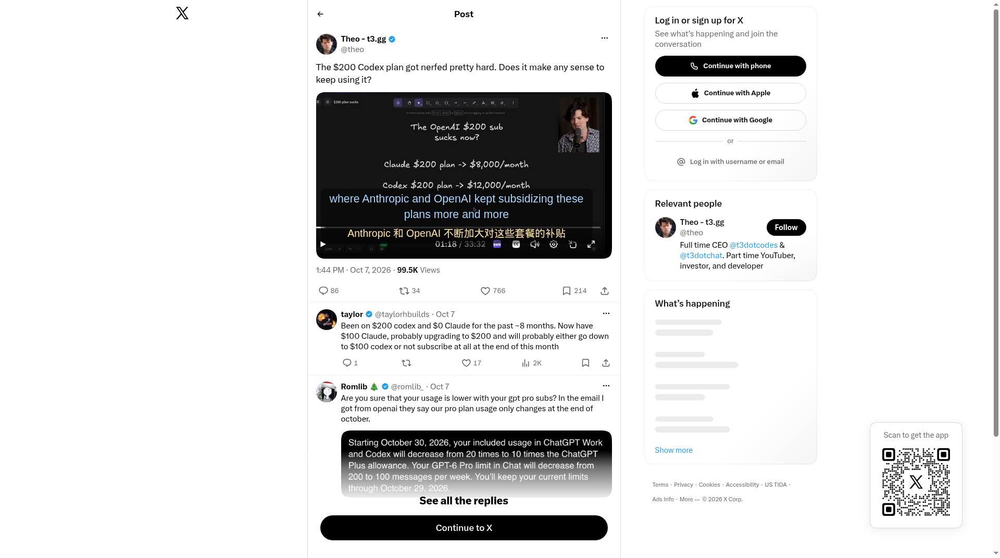

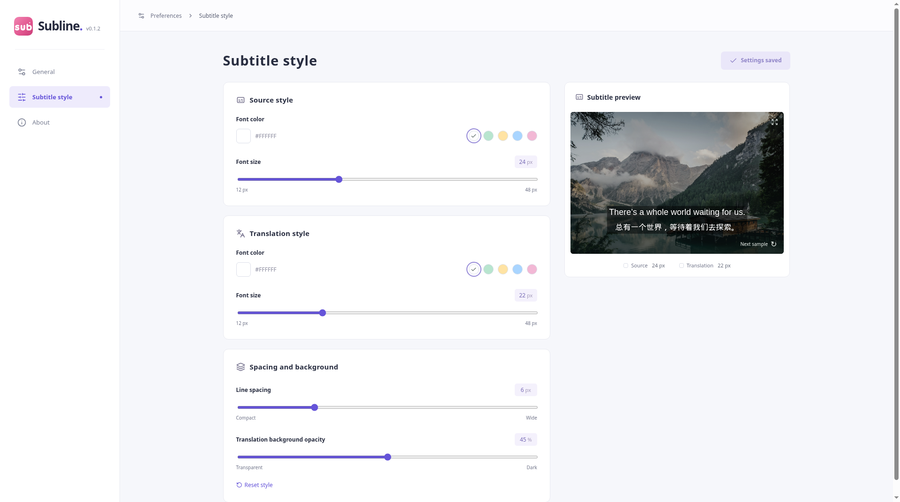

### TC-YT-playback · pass

- 实际：广告 Skip 一次。Skip 后约 0:02 出现双语。播放、暂停、seek、1.25× 再恢复 1×、进入全屏再退出，都实际操作过；退出全屏后字幕仍在。关闭双语后译文消失、原生英文保留；再开启后双语恢复。
- 缺口：各步没有精确毫秒记录。全屏图是进入全屏时的画面；退出后字幕仍在写在实际结果里。
- 证据：

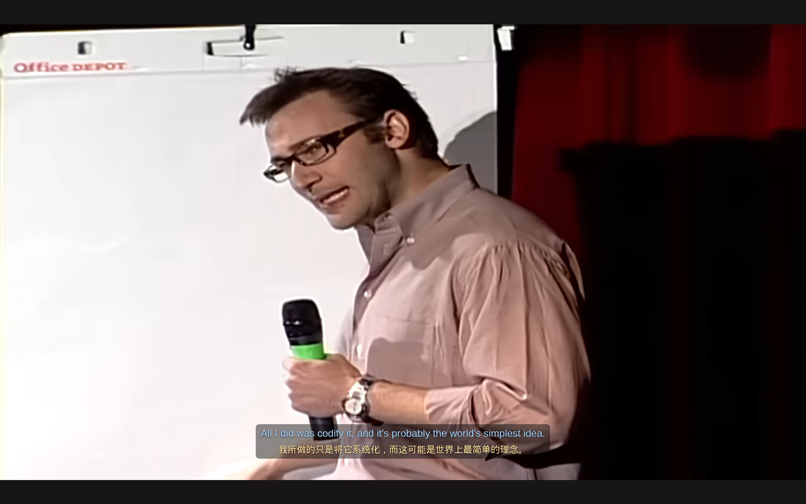

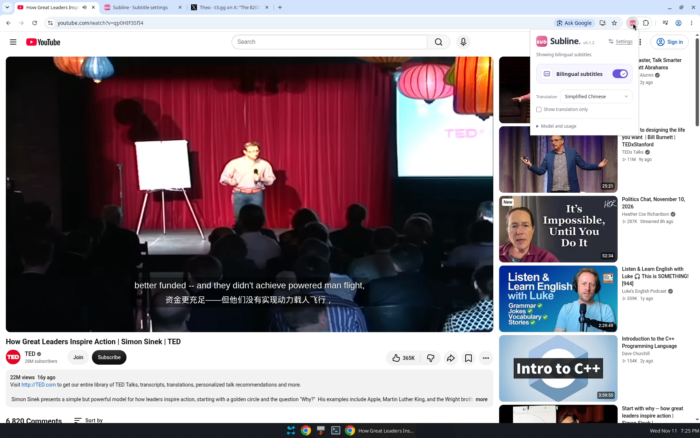

下面这张是播放过程中的对照：popup 显示 Showing bilingual subtitles，画面有双语。它不是刚刚在同一个 popup 里拨动开关的那一帧。

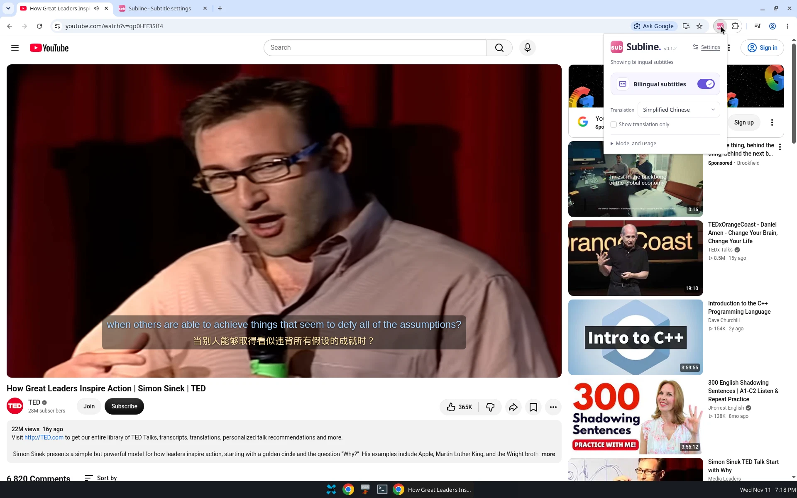

### TC-A11Y-smoke · pass

- 实际：Tab 可以到达 Subtitle style 页的 Source font color 文本框和 Font size 滑块。
- 缺口：未留截图。未测对比度、读屏和其余控件。本条不关闭无障碍方面尚未验证的内容。

## 这次没有另立缺陷的事项

- TC-158-X-small 只是可见尺寸下的局部结果。[#158](https://github.com/weiguangchao/openai-translate-chrome-extension/issues/158) 继续打开。
- TC-X-fullscreen 被 X 登录提示挡住。这是 `blocked`，不是缺陷。
- TC-159-connection 只覆盖 Test connection 和重开后的对应状态。设置页 Saved 与 Not tested 的语义仍以 [#159](https://github.com/weiguangchao/openai-translate-chrome-extension/issues/159) 为准。
- TC-160-popup、TC-160-style、TC-A11Y-smoke 只覆盖各自步骤。[#160](https://github.com/weiguangchao/openai-translate-chrome-extension/issues/160) 里的信息架构建议保持为建议。

## 其余截图索引

BUG-01 的 E1–E5 已在上文展开。其余 12 张也是真实截图，对应用例见各条。

| 文件 | 用例 | 种类 |
| --- | --- | --- |
| `extensions-reload-confirmation.webp` | TC-ENV-reload | 真实截图 |
| `x-small-window-controls-original.webp` | TC-158-X-small；同帧可见登录提示，供 TC-X-fullscreen 的 blocked 说明 | 真实截图 |
| `x-popup-status-small-window.webp` | TC-158-X-small | 真实截图 |
| `x-small-window-initial.png` | TC-158-X-small | 真实截图 |
| `popup-model-usage-expanded.webp` | TC-160-popup | 真实截图 |
| `style-preview-temporary-colors.png` | TC-160-style | 真实截图 |
| `x-style-actual-applied.png` | TC-160-style | 真实截图 |
| `style-restored-default.png` | TC-160-style | 真实截图。恢复后的读数，不是改色前快照 |
| `youtube-after-skip-captions.png` | TC-YT-playback | 真实截图 |
| `youtube-fullscreen-subtitles.png` | TC-YT-playback | 真实截图 |
| `youtube-post-skip-popup-state.webp` | TC-YT-playback | 真实截图 |
| `youtube-playing-bilingual-popup.webp` | TC-YT-playback | 真实截图。未在同一 popup 内刚刚拨动开关 |

TC-159-connection 与 TC-A11Y-smoke：未留截图。

## 与用例库状态的对应

本文件原结论保持不变。表中的 `pass` / `fail` / `partial` / `blocked` 在用例库里写成通过 / 失败 / 部分通过 / blocked。

本运行没有执行 [用例库](../cases.md) 里的 `SL-REG-` 历史回归。那些条的状态是历史来源待实测或适用性说明，不能从本文件的 12 条结果改成通过。`SL-BUG-001` 就是本文件的 BUG-01，映射到 `TC-159-state-*`。
