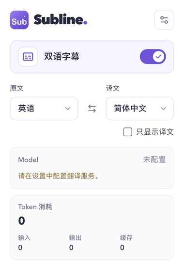
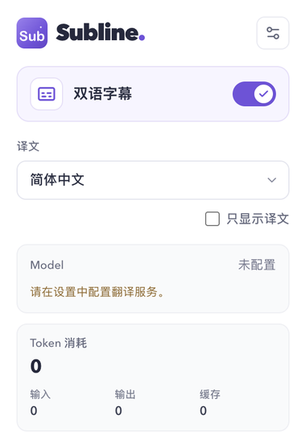

# 自动识别字幕语言

用户只选择译文语言，支持英语、简体中文、繁体中文和日语。播放器中的当前字幕轨道决定输入语言。保留视频字幕和译文双行显示、原文样式及「只显示译文」开关。旧设置中的 `sourceLanguage` 在读取时移除，已选译文语言保留。

平台适配器把实际字幕语言与时间轴一起交给 `CaptionController`。`supportedLanguage` 统一处理语言标签，例如 `ja-JP`、`zh-Hans`、`zh-Hant` 和 `zh-HK`。YouTube 自动翻译的英语只代表站方显示语言，扩展仍下载其日语原生轨道，并移除下载地址中的 `tlang`。

`CaptionTranslator` 根据字幕内容和实际语言维护显示状态。翻译请求携带 `captionLanguage`，后台校验后生成 Provider 提示词，缓存也包含实际语言。相同文本来自不同语言时，不共用译文。输入语言与译文语言相同时，允许 Provider 返回相同文本。

不支持或无法识别的字幕语言进入 `unsupported-language` 状态，在译文位置显示「原文语言不支持」。平台在下载前拦截已知的不支持语言，后台也拒绝缺失或不支持语言的翻译请求。关闭字幕与尚未发现字幕轨道时不显示这条提示。

英语保留原有断句规则。中文和日语共用标点边界与分段算法，按各自的 `Intl.Segmenter` locale 分词。实际字幕标签先归一化，再选择断句规则。

## 验证

弹窗回归测试在改动前因两个语言选择器失败。日语断句回归测试在修复前因不能识别句末标点、不能拆分无空格长句失败，修复后通过。

真实 Chrome 页面验证使用 [用户提供的视频](https://www.youtube.com/watch?v=ph-Vrc_33Ac)。播放器只提供 `a.ja` 日语 ASR 轨道，同时选择了站方英语自动翻译。新版页面脚本读取到 420 条日语字幕，首条为「さてと。」。下载请求为 `lang=ja`，没有 `tlang`。首次请求尚无 YouTube 的字幕请求上下文，返回空响应；在播放器重新打开字幕后，新版脚本使用观察到的上下文成功读取时间轴。

真实页面验证了轨道识别和字幕读取。Provider 请求及显示通过三平台的打包扩展测试验证，覆盖英语、简繁中文、日语 ASR、法语拒绝、轨道关闭与切回缓存字幕。

全量 `npm run verify` 通过，包含 53 项端到端测试及 68 项 Chrome 调试工具测试。收尾变更后再次通过 `npm run check`、全部 723 项单元测试、构建，以及三平台共 14 项字幕端到端测试。测试均按现有超时配置运行，没有超时失败。

## 弹窗前后对比

| 修改前                                                          | 修改后                                                         |
| --------------------------------------------------------------- | -------------------------------------------------------------- |
|  |  |
