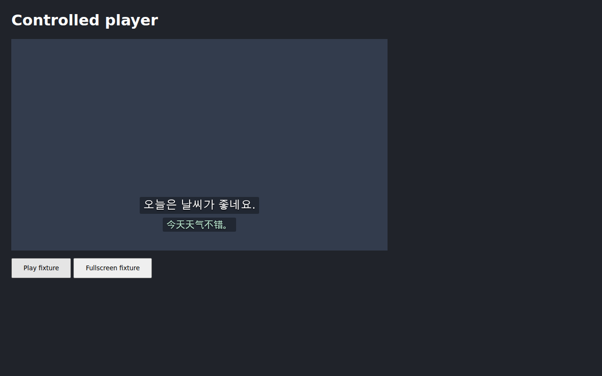
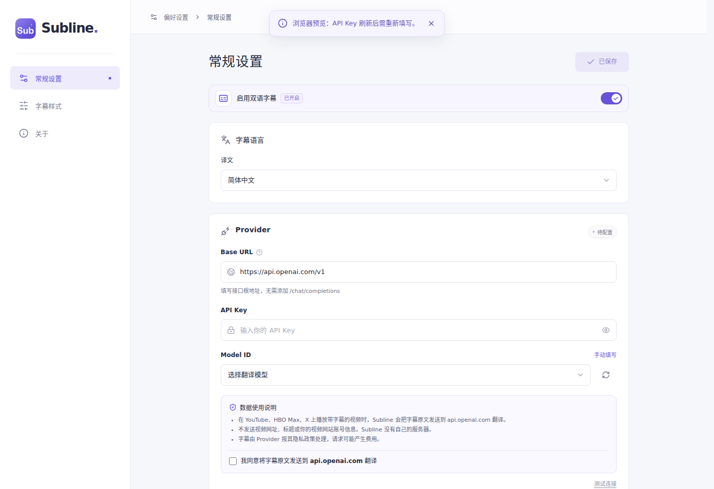
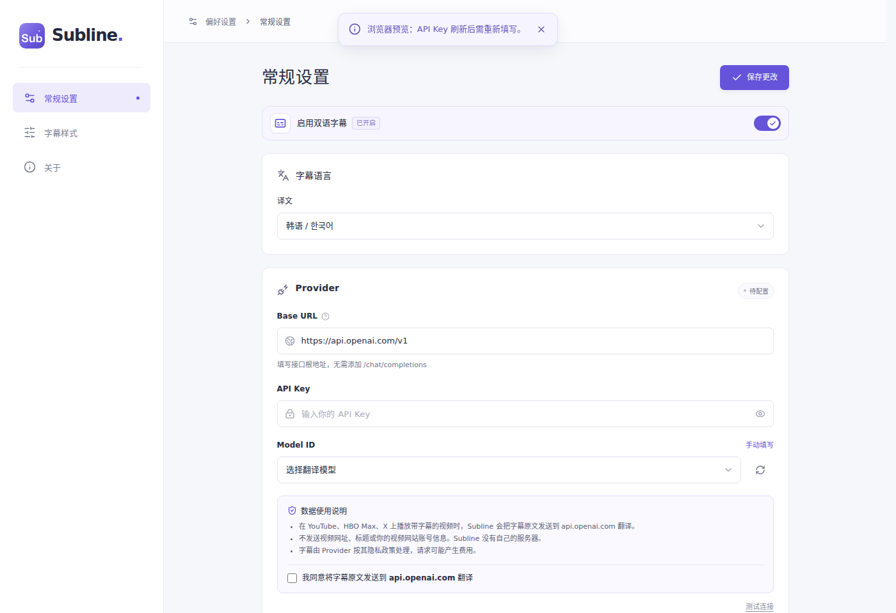

# 韩语字幕支持

[用户报告的 X 视频](https://x.com/SirD___/status/2114271095985435041)显示 `Unsupported subtitle language`。[实际 HLS 主清单](https://video.twimg.com/amplify_video/2114270945095380992/pl/eDZ-AZ5URtkQDt9B.m3u8?v=31e)只声明一条字幕轨道，名称为 `ko (auto-generated)`，语言为 `ko`。下载的 WebVTT 内容为韩文。

共享语言表加入韩语，三个平台均可读取韩语字幕，设置页和弹窗也可选择韩语译文。地区和大小写标签归一为 `ko`，显式指定拉丁脚本的 `ko-Latn` 仍被拒绝。Provider 的语言名称来自同一张表。

韩语复用现有的空格和标点断句规则。回归用例覆盖韩语句末标点、引号和长段落拆分。设置页加入两个韩语预览示例，README、关于页和项目语言规则同步更新。

## 修改前的验证

`npm test -- tests/languages.test.ts tests/api.test.ts tests/popup.test.tsx tests/segmenter.test.ts` 在修改前有 7 项预期失败，分别涉及韩语识别、译文设置和弹窗选项。类型检查通过。

`SUBLINE_E2E_OUTPUT_DIR=.artifacts/korean-before npm run test:e2e -- e2e/caption-sources.spec.ts --grep 'x: caption language'` 在旧版扩展上失败。选择韩语字幕后页面显示不支持语言，韩语原文断言等待现有的 8 秒后超时。未调整超时或重试配置。

## 修改后的验证

相关的 173 项测试和类型检查通过。浏览器检查确认韩语选项和两个韩语预览示例可显示。

三平台语言切换端到端用例通过。它们使用真实 Chromium 加载打包扩展，播放清单、字幕和 Provider 响应由夹具提供。用例检查韩语原文与译文显示、Provider 提示词中的 Korean，以及不支持语言的请求拦截。

完整 `npm run verify` 通过，包含静态检查、测试发现、767 项单元测试、类型检查、68 项调试工具测试、商店版构建和 53 项端到端测试。端到端测试按真实时间运行，耗时 11.4 分钟，没有失败或超时。

## 界面对照

X 播放器截图来自上述端到端夹具。修改前显示语言不支持，修改后显示韩语原文和中文译文。

设置页新增韩语译文选项。

